# Garden critters

30 animated 32×32 pixel critters on one shared 14-colour palette, as GIF, PNG and SVG.

| | | | | | |
|---|---|---|---|---|---|
| 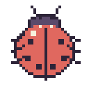<br>ladybug | 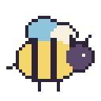<br>bee | 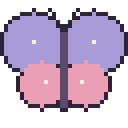<br>butterfly | 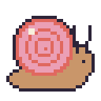<br>snail | 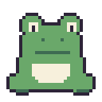<br>frog | 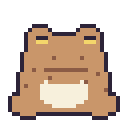<br>toad |
| 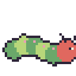<br>caterpillar | 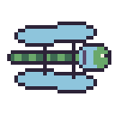<br>dragonfly | 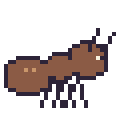<br>ant | 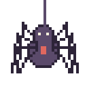<br>spider | 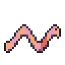<br>worm | 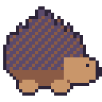<br>hedgehog |
| 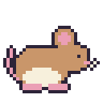<br>mouse | 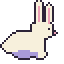<br>rabbit | 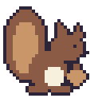<br>squirrel | 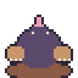<br>mole | 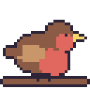<br>robin | 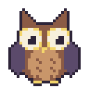<br>owl |
| 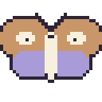<br>moth | 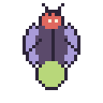<br>firefly | 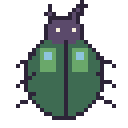<br>beetle | 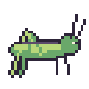<br>grasshopper | 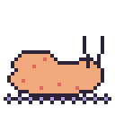<br>slug | 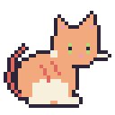<br>cat |
| 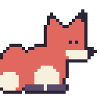<br>fox | 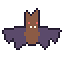<br>bat | 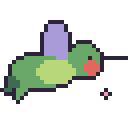<br>hummingbird | 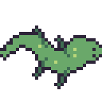<br>lizard | 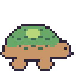<br>tortoise | 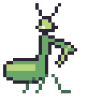<br>mantis |

## Files

All output is in [`assets/critters/`](../assets/critters):

- `gif/` – the animated 32×32 GIFs (2 or 4 frames, transparent background).
- `gif-4x/` – the same GIFs scaled 4× with sharp pixels (128×128), handy for previews.
- `png/` – first frame at 256×256, transparent.
- `svg/` – first frame as crisp SVG, one rectangle run per row.
- `sheet.png` – contact sheet of every critter.

Use `image-rendering: pixelated;` in CSS when showing the 32×32 files bigger than their native size.

## Regenerate

```sh
uv run --with pillow python _pixel/critters.py
```

Each critter is a small function in [`critters.py`](critters.py) that draws shapes for a given frame. Add one to `CRITTERS` to make another. `test/` holds the earlier 16×16 frog test.

## Palette

| name | hex |
|---|---|
| ink | `#2d2438` |
| plum | `#5b4a6b` |
| moss | `#3e6b52` |
| leaf | `#6aa86a` |
| lime | `#b8d77a` |
| cream | `#f7f0dc` |
| butter | `#f4d66b` |
| peach | `#f2a97e` |
| coral | `#e0685f` |
| rose | `#eb9fb5` |
| sky | `#8ec5dc` |
| lav | `#a99bd8` |
| bark | `#8b5b45` |
| tan | `#c9966a` |
